<p align="center">
  <picture>
    <source media="(prefers-color-scheme: dark)" srcset="docs/images/logo-dark.svg">
    
  </picture>
</p>

<p align="center">
  <b>El ticket tracker open source donde personas y agentes de IA trabajan el mismo proyecto.</b><br>
  Self-hosted · MCP integrado · Buzón para tus usuarios · AGPLv3
</p>

<p align="center">
  <a href="LICENSE"></a>
  <a href="CONTRIBUTING.md"></a>
  <a href="README.md"></a>
</p>

<p align="center">
  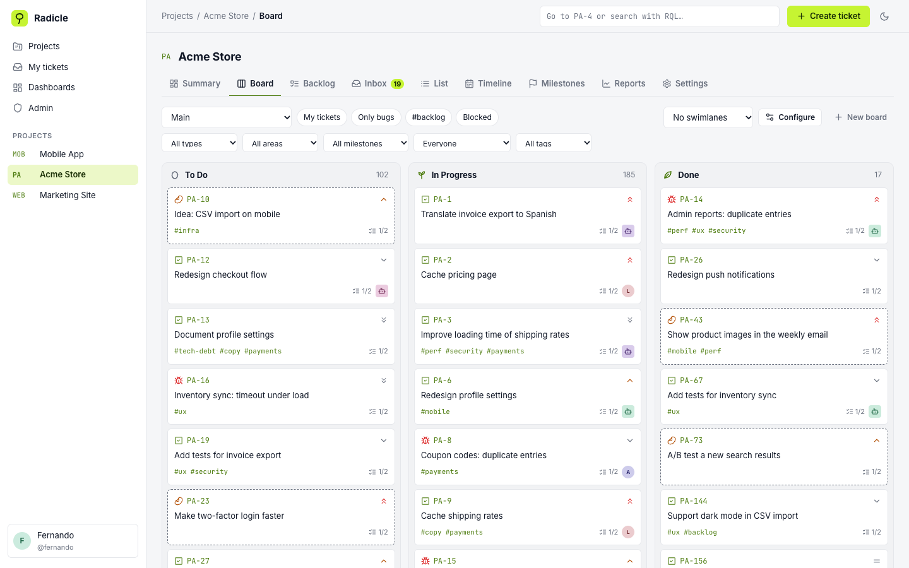
</p>

> 🌱 **Radicle** viene de *radícula*: la primera raíz que saca una semilla al germinar.

>  **Radi:** ¡Hola! Soy Radi, el verdecito de la esquina de la app (y del logo). Te acompaño por este README: busca mis notas al inicio de cada sección.


Esta es la versión en español del README. La versión principal, en inglés, es [README.md](README.md). La interfaz de Radicle está en inglés y en español; los screenshots están en inglés.

## Contenido

- [Por qué Radicle](#-por-qué-radicle)
- [Inicio rápido](#-inicio-rápido)
- [Conoce a Radi](#-conoce-a-radi)
- [Guía de uso](#-guía-de-uso)
- [Configuración](#%EF%B8%8F-configuración)
- [Arquitectura](#%EF%B8%8F-arquitectura)
- [Desarrollo](#-desarrollo)
- [Roadmap y pendientes](#%EF%B8%8F-roadmap-y-pendientes)
- [Cómo contribuir](#-cómo-contribuir)
- [Licencia](#-licencia)

## ✨ Por qué Radicle

| | |
| --- | --- |
| 🤖 **Los agentes son parte del equipo** | Trae un servidor MCP (Model Context Protocol) adentro. Claude, Cursor o cualquier cliente MCP toma un ticket, lo mueve, marca su checklist, registra tiempo y comenta, y todo queda en el historial como hecho por ese agente. |
| 📮 **Escucha a tus usuarios** | Cada proyecto puede abrir un formulario público. Quejas e ideas llegan a un **Buzón**, las calificas en una matriz de impacto por esfuerzo y conviertes las buenas en tareas o bugs. Quien las mandó las sigue con un código. |
| 🔒 **Control de acceso en serio** | Grupos, matriz de permisos por proyecto, tickets restringidos que no aparecen en ningún lado (búsqueda, boards, reportes, MCP), SSO con OpenID Connect y un audit log que nadie puede modificar. |
| 🗺️ **Planea y ve** | Boards Kanban y Scrum, sprints, timeline con pronóstico, diez reportes agile y generales, y dashboards que armas arrastrando. |
| 🟢 **Una guía adentro** | Radi, la mascota, responde cómo hacer las cosas con la guía de uso y, con el LLM que elijas, te lleva por la pantalla paso a paso. |
| ⚡ **Rápido para trabajar** | Lenguaje de queries (RQL), paleta de comandos, atajos para todo y temas claro y oscuro. En inglés y en español. |
| 🏠 **Tuyo** | Un `docker compose up`. PostgreSQL, tu servidor, tus datos. |

## 🚀 Inicio rápido

>  **Radi:** Tres comandos y listo. La primera visita te pide crear el admin de la instancia.

Necesitas Docker con Compose.

```bash
git clone https://github.com/ego-mejia/radicle.git
cd radicle
cp .env.example .env
# Obligatoria: un secreto largo y aleatorio. Cifra los secretos guardados y firma links.
echo "RADICLE_SECRET_KEY=$(openssl rand -hex 32)" >> .env
docker compose up -d
```

Abre <http://localhost:8000>. La primera vez aparece la pantalla de **setup** para crear al admin de la instancia.

Se levantan tres contenedores: `app` (web, API REST y MCP), `worker` (trabajos en segundo plano) y `db` (PostgreSQL 16). La API vive en `/api/v1` y su documentación interactiva en `/api/docs`.

> [!TIP]
> En producción, pon Radicle detrás de HTTPS y define `RADICLE_BASE_URL` con su URL pública. Las cookies se vuelven `Secure` solas.

## 🟢 Conoce a Radi

>  **Radi:** ¡Ese soy yo! Dame clic en la esquina inferior derecha de cualquier página y pregúntame cómo hacer algo. Mis ojos siguen tu cursor y crezco un poquito cuando pasas encima.

Radi responde preguntas sobre cómo usar Radicle y te enseña dónde están las cosas.

- **Sin configurar nada**, Radi responde con la guía de uso incluida (en inglés y español) y ofrece un recorrido ya hecho para los temas principales: da clic en **Show me**.
- **Con un LLM** (Anthropic, OpenAI o cualquier servidor compatible con OpenAI, como Ollama), Radi responde en el idioma en que preguntaste y te lleva por la pantalla: un cursor blanco con brillo verde va a cada botón, abre páginas y diálogos, ilumina cada campo y lo explica. Nunca da clic en **Create**, **Save** ni **Add** por ti; solo los señala.
- Después de cada respuesta Radi vuelve a mostrar las preguntas sugeridas para que sigas preguntando.

<p align="center">
  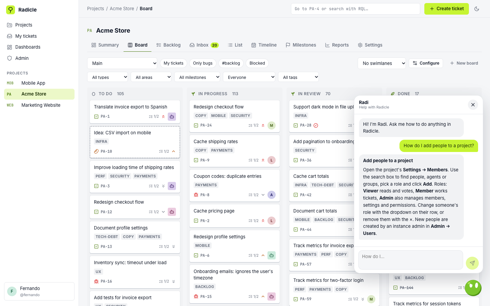
  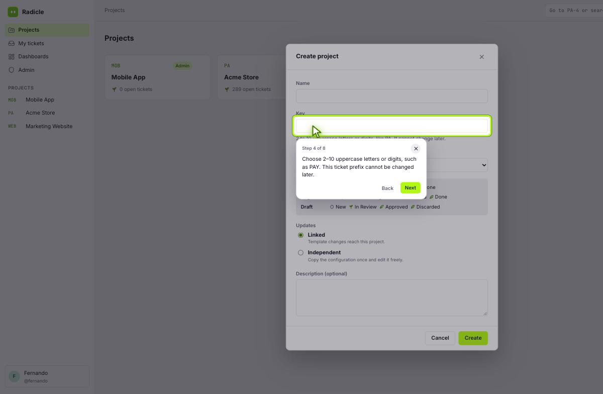
</p>

**Configura el LLM** en **Admin → Settings → Assistant**: elige el proveedor, pega la API key (se guarda cifrada y no se vuelve a mostrar) y, si quieres, el modelo y la base URL; luego da clic en **Test**. Las variables de entorno mandan sobre lo de la app, útil cuando no quieres secretos en la base de datos:

| Variable | Qué hace |
| --- | --- |
| `RADICLE_ASSISTANT_PROVIDER` | `anthropic`, `openai` o `none` |
| `RADICLE_ASSISTANT_API_KEY` | La API key del proveedor |
| `RADICLE_ASSISTANT_MODEL` | Opcional; por defecto `claude-haiku-5-5` o `gpt-4o-mini` |
| `RADICLE_ASSISTANT_BASE_URL` | Opcional; para servidores compatibles con OpenAI, como `http://ollama:11434/v1` |

<p align="center">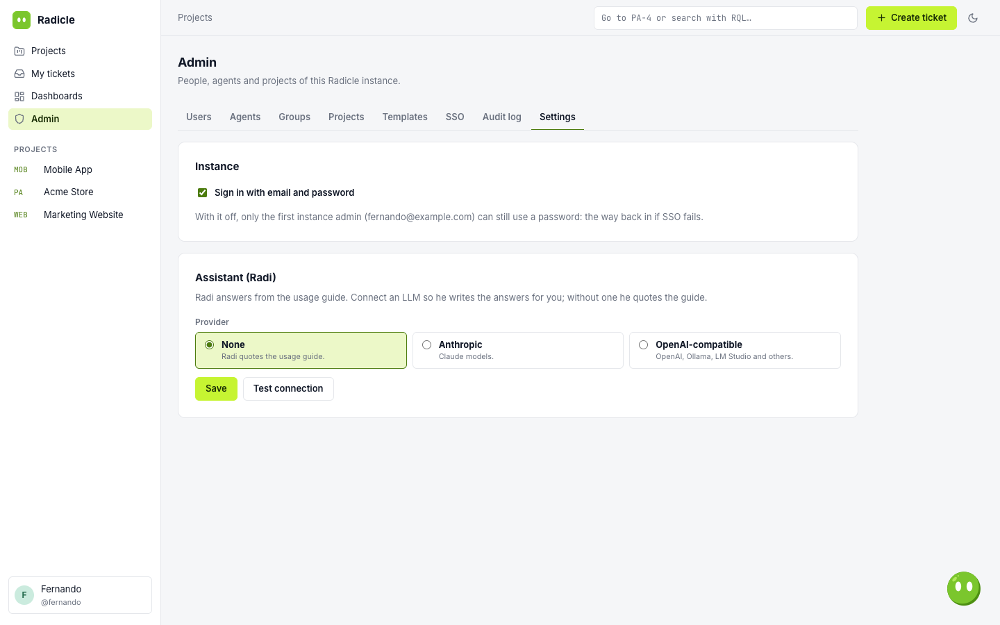</p>

Radi solo puede señalar un catálogo fijo de lugares de la app, así que un modelo no puede inventar botones. La guía con la que responde vive en `backend/radicle/services/assistant/guide/`.

## 📖 Guía de uso

### 1. Crea tu primer proyecto

>  **Radi:** Pregúntame "¿cómo creo un proyecto?" y te llevo al botón y te explico cada campo del diálogo.

En **Projects**, da clic en **Create project**. Ponle nombre y una **key** corta (de 2 a 10 mayúsculas o dígitos, como `PAY`). Cada ticket la lleva de prefijo (`PAY-12`) y no se puede cambiar después.

Elige un **template**: trae los workflows (estados y transiciones de Task, Bug y Draft), campos custom y políticas. **Linked** sigue recibiendo los cambios del template; **Independent** lo copia una vez para que lo edites libremente.

<p align="center">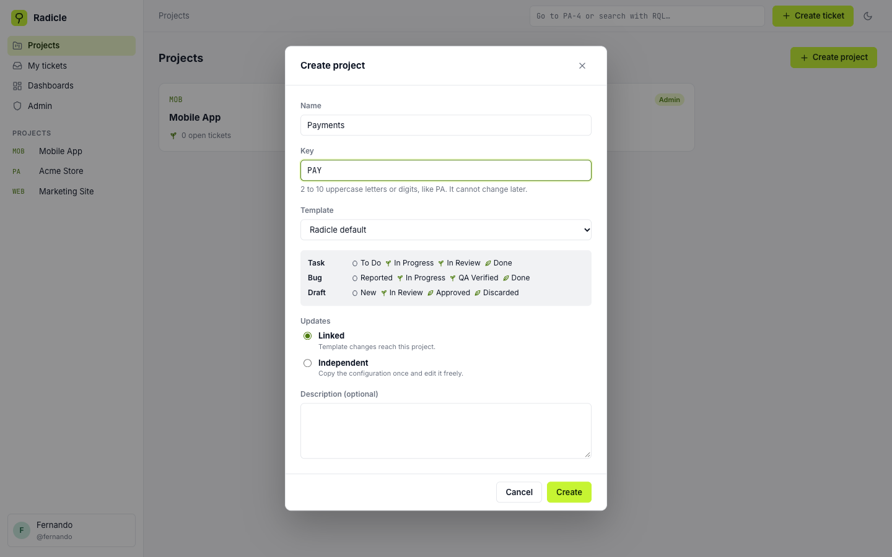</p>

Luego, en **Settings** del proyecto, agrega **Areas** (Backend, Mobile, Legal...) y **Milestones** (V1, V2...). Toda task y todo bug pertenecen a un área; los milestones son opcionales.

Para cambiar el nombre o la descripción de un proyecto, pasa el cursor sobre su tarjeta en **Projects** y da clic en el lápiz. La key nunca cambia. Los proyectos no se borran: un admin del proyecto puede darle **Archive** en **Settings → General**, y queda de solo lectura con todo su historial.

### 2. Agrega gente

>  **Radi:** Los proyectos son mejores acompañados. Así se suman personas, grupos y agentes.

Un admin de instancia crea a las personas en **Admin → Users**, o llegan solas por [SSO](#11-single-sign-on-sso). Para darles acceso a un proyecto, abre **Settings → Members**, busca a la persona, agente o grupo en el menú, elige un rol y da clic en **Add**. Cambia el rol desde el menú de cada fila:

| Rol | Puede |
| --- | --- |
| **Viewer** | Ver todo el proyecto y votar. |
| **Member** | Lo mismo que un viewer, más crear, editar, mover y comentar tickets. |
| **Admin** | Todo, más administrar miembros, configuración, workflows y permisos. |

<p align="center">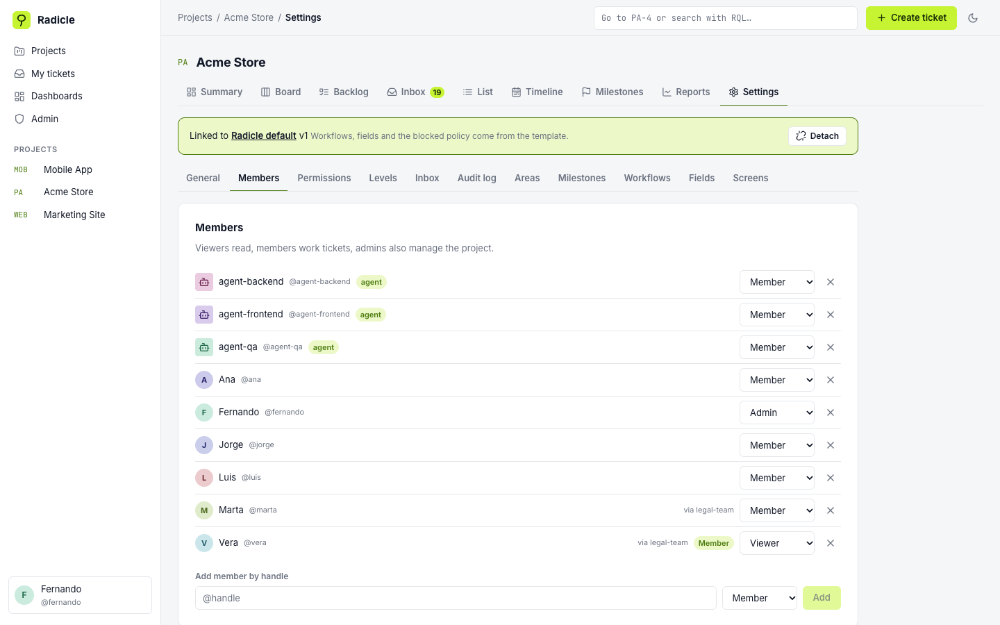</p>

Para equipos, crea un **grupo** en **Admin → Groups** (por ejemplo `legal-team`) y dale un rol en el proyecto. Todos sus integrantes entran de una vez, y también quien se sume después. Si alguien tiene varios roles (directo y por grupos), vale el más alto.

Los agentes de IA se agregan igual: ve [Agentes de IA por MCP](#13-agentes-de-ia-por-mcp).

### 3. Trabaja los tickets

>  **Radi:** Los tickets son donde vive el trabajo. Presiona <kbd>c</kbd> en cualquier lado para crear uno.

Presiona <kbd>c</kbd> o da clic en **Create ticket**. Hay tres tipos:

- **Task**: trabajo por hacer.
- **Bug**: algo roto.
- **Draft**: una idea o petición que todavía no se decide. Los Drafts viven en el [Buzón](#9-buzón-y-formulario-público).

<p align="center">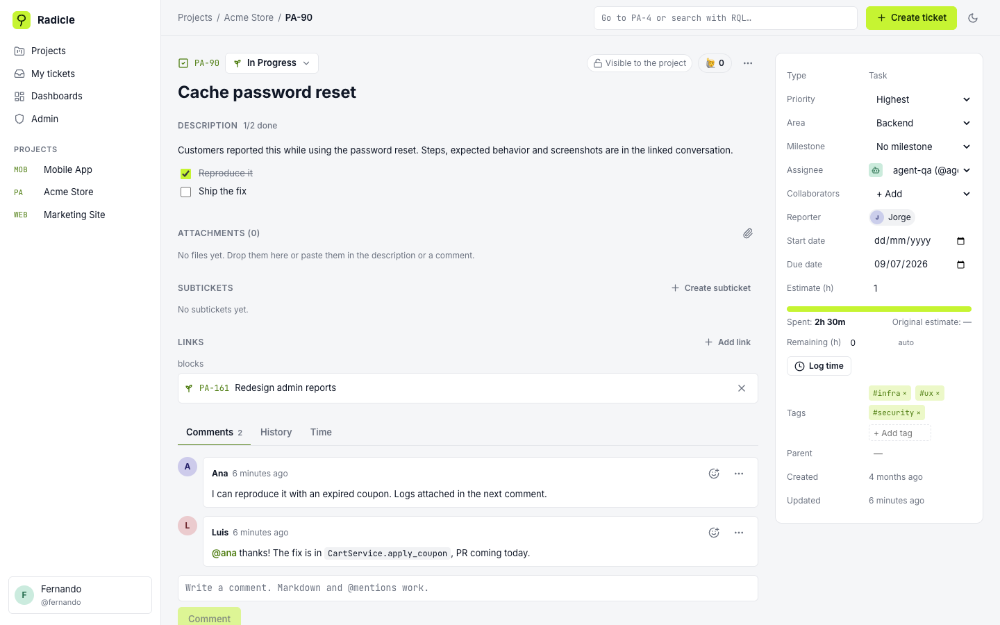</p>

Un ticket tiene descripción en markdown con **checklist**, además de prioridad, área, milestone, assignee, colaboradores, fechas, estimado, tags y ticket padre. Abajo están los adjuntos (las imágenes se reducen solas), subtickets, links (`blocks`, `relates to`, `duplicates`, `clones`), comentarios con `@menciones` y reacciones, y el **historial** completo.

- **Muévelo** con el botón de estado. Los workflows pueden pedir resolution, comentario o checklist completo antes de una transición.
- **Registra tiempo** con **Log time**. Lo invertido y lo restante se actualizan al momento.
- **Vota** con 🙋 para decir que te importa.
- Desde el menú **⋯** lo clonas, lo mueves a otro proyecto o lo borras (un admin puede restaurarlo).

<p align="center">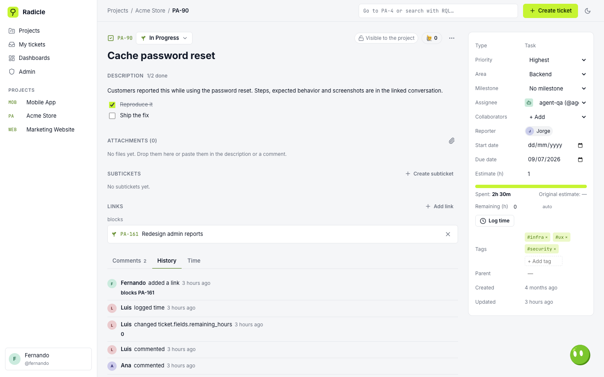</p>

### 4. Boards

>  **Radi:** Arrastra una tarjeta y suéltala donde quieras: ahí se queda y brilla. ¡Si la sueltas en Done brilla todavía más!

Cada proyecto empieza con un board Kanban llamado **Main**, con **To Do**, **In Progress**, **In Review** y **Done**. Arrastra tarjetas entre columnas y caen justo donde las sueltas; la tarjeta movida destella una vez, y la que llega a una columna de terminado destella más fuerte. Los quick filters (**My tickets**, **Only bugs**, `#backlog`, **Blocked**) y la barra de filtros lo acotan.

Los **carriles** (swimlanes) dividen el board en filas por área, assignee, prioridad, milestone, padre o tipo, como varios boards apilados. Da clic en el encabezado de una fila para plegarla, o usa **Collapse all**; Radicle recuerda cuáles plegaste.

<p align="center">
  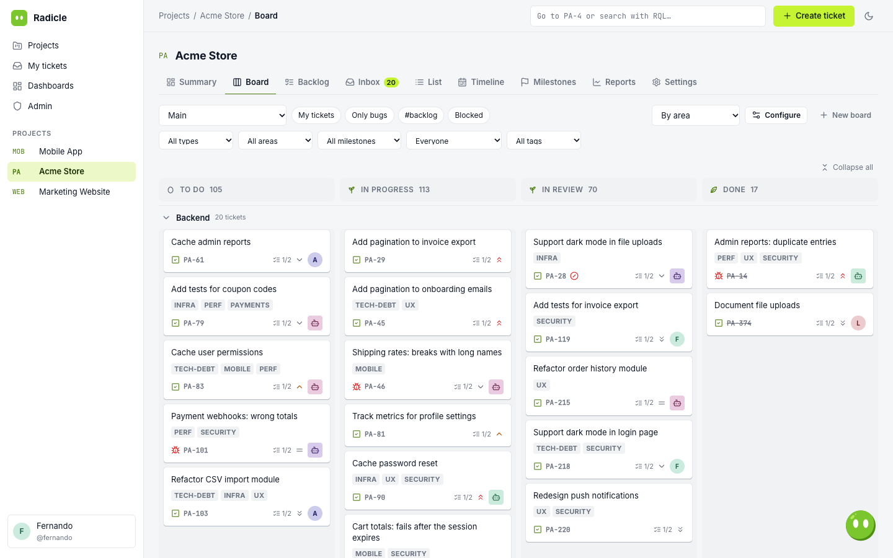
  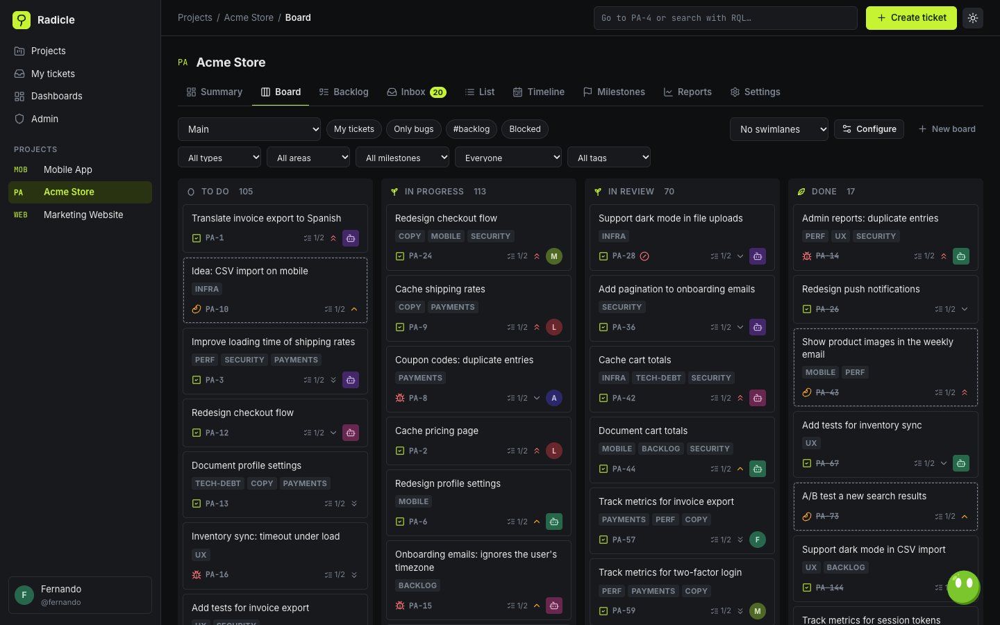
</p>

Los admins crean más boards con **New board** y los configuran en **Configure**:

- **Origen**: una query RQL, así un board puede abarcar un área o varios proyectos.
- **Columnas**: por estado o por categoría, con **límites WIP**. Los suaves ponen la columna en rojo; los duros bloquean el movimiento (un admin puede forzarlo).
- **Campos de la tarjeta** y **quick filters**.

### 5. Busca con RQL

>  **Radi:** ¿Buscas algo preciso? RQL lo encuentra. En **List**, el botón **Filter** arma las queries sencillas por ti.

RQL (Radicle Query Language) funciona en la barra de búsqueda, en **List**, en los boards y en los filtros guardados:

```text
type = bug AND priority >= high AND assignee = currentUser()
project IN (PA, MOB) AND category != done ORDER BY due ASC
text ~ "checkout" AND updated >= -7d
sprint = active AND #backlog
classification = complaint AND origin = user ORDER BY votes DESC
```

Los errores se subrayan en su lugar con lo que se esperaba, y el editor autocompleta campos y valores. Guarda una query como **filtro** para reusarla, compartirla o ponerla en un dashboard. Los agentes leen la guía completa en el recurso MCP `radicle://guide/rql`.

**List** muestra los tickets en una tabla. Da clic en **Filter** arriba de ella para filtrar por tipo, estado, prioridad, assignee, área o milestone sin escribir RQL (cada filtro es un chip que puedes quitar), en **Group by** para dividir las filas en grupos plegables y en **Saved filters** para reusar queries. Los tickets con subtickets tienen una flecha que abre sus tareas y bugs justo debajo.

<p align="center">
  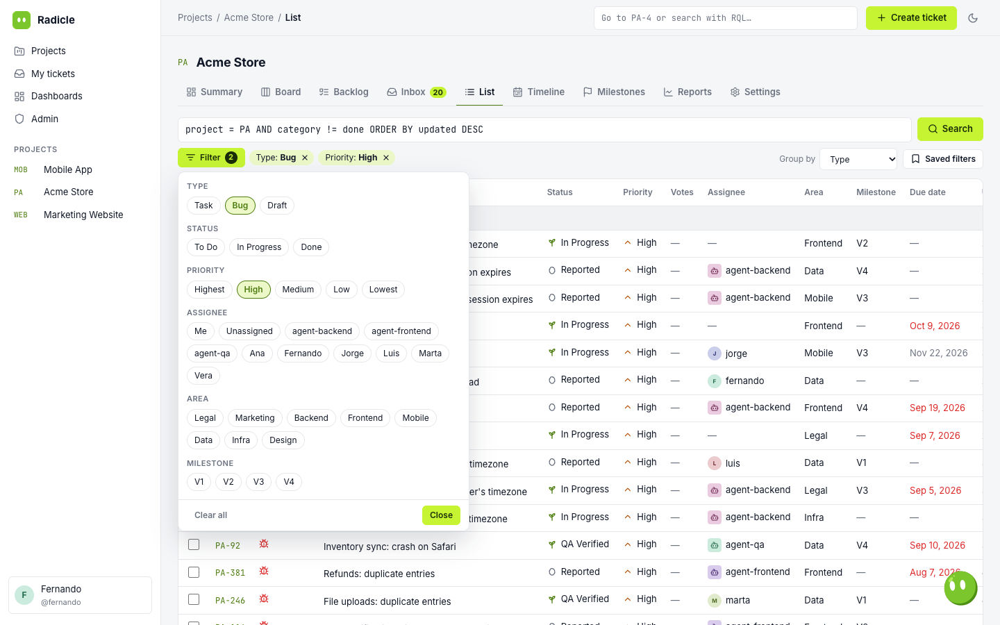
  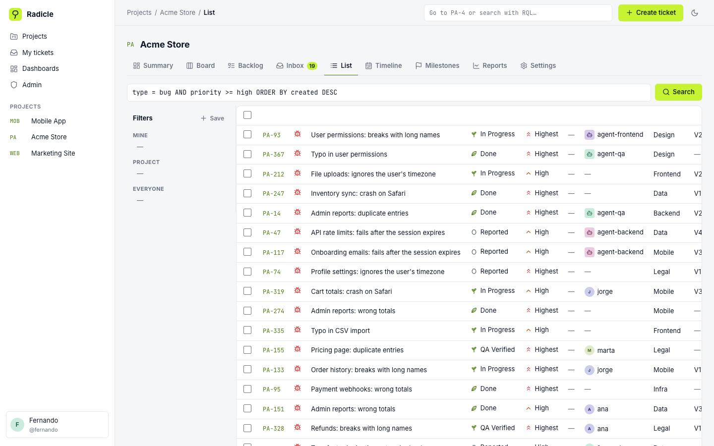
</p>

### 6. Sprints y backlog

>  **Radi:** ¿Vas a planear en sprints? Primero necesitas un board Scrum; pregúntame y te enseño dónde.

Crea un board de tipo **Scrum** para planear en sprints. Luego, en **Backlog**:

1. **New sprint**, con objetivo, fechas y capacidad en horas.
2. Arrastra tickets adentro. La barra compara horas comprometidas contra capacidad y avisa de tickets sin estimado.
3. **Start sprint**. Lo que está adentro se vuelve el compromiso.
4. **Complete sprint**. Lo no terminado regresa al backlog (con `#backlog`) o pasa al siguiente sprint, y se guarda el reporte del sprint.

<p align="center">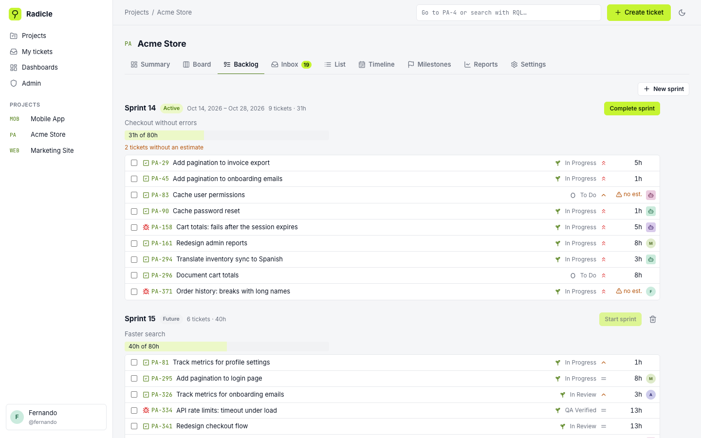</p>

### 7. Timeline y milestones

>  **Radi:** Mi parte favorita: cuando el último ticket de un milestone queda en Done, hago fiesta.

**Timeline** dibuja los tickets en el tiempo, agrupados por milestone o área, por semana, mes o trimestre. Arrastra una barra para cambiar sus fechas, o un ticket de **Without dates** para dárselas. Un ticket con solo fecha límite se dibuja con una barra tenue desde el día en que se creó (uno con solo fecha de inicio, con una barra tenue tan larga como su estimado) hasta que tenga ambas fechas. Las dependencias imposibles (un ticket que empieza antes de que termine lo que lo bloquea) se ponen en rojo, y los milestones muestran su pronóstico.

<p align="center">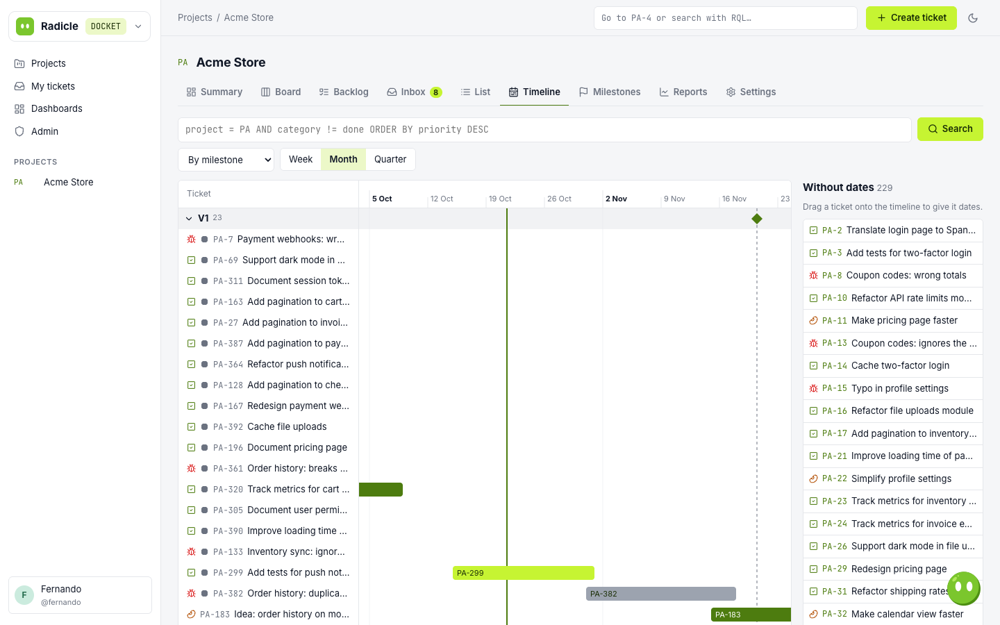</p>

Los **milestones** son metas con fecha objetivo opcional, como un release. Cuando el último ticket abierto de un milestone llega a done, Radicle lo celebra: confeti, Radi festejando y los números detrás (tickets entregados, horas invertidas, bugs aplastados, tareas, ideas, días para entregar y las personas y agentes de IA que lo lograron). **Share on LinkedIn** copia una imagen lista a tu portapapeles y abre un post con el texto escrito; **Download image** la descarga.

<p align="center">
  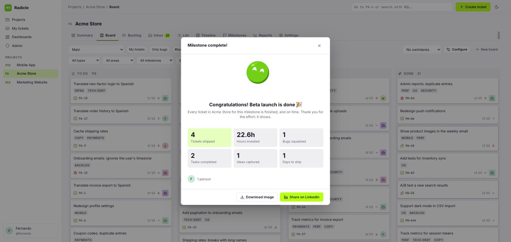
  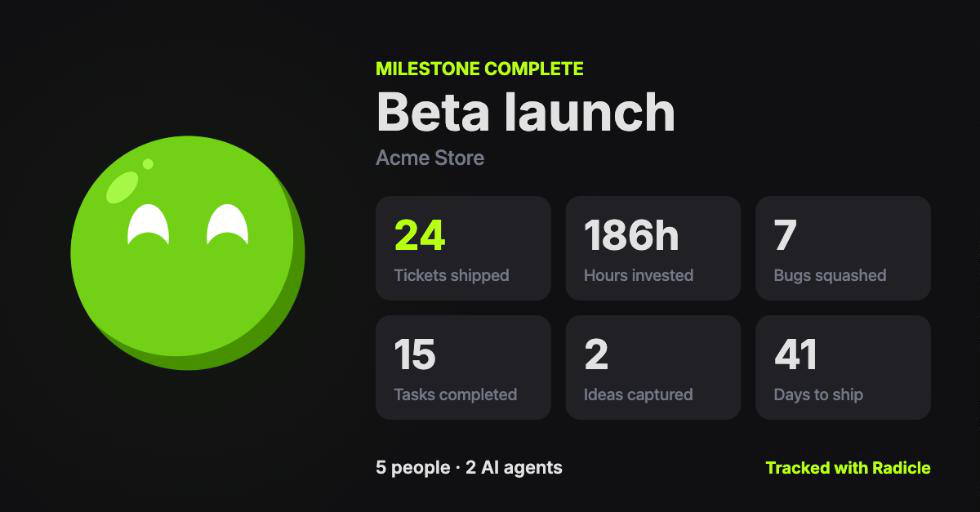
</p>

### 8. Reportes y dashboards

>  **Radi:** Números, gráficas y un CSV para cada una. Cada quien ve solo los tickets que puede ver.

**Reports** tiene burndown, burnup, velocity, cumulative flow, control chart, sprint report, creados vs resueltos, distribución, progreso de milestone (con pronóstico y aviso de "en riesgo") y tiempo. Cada uno trae su tabla de datos y **Export CSV**.

<p align="center">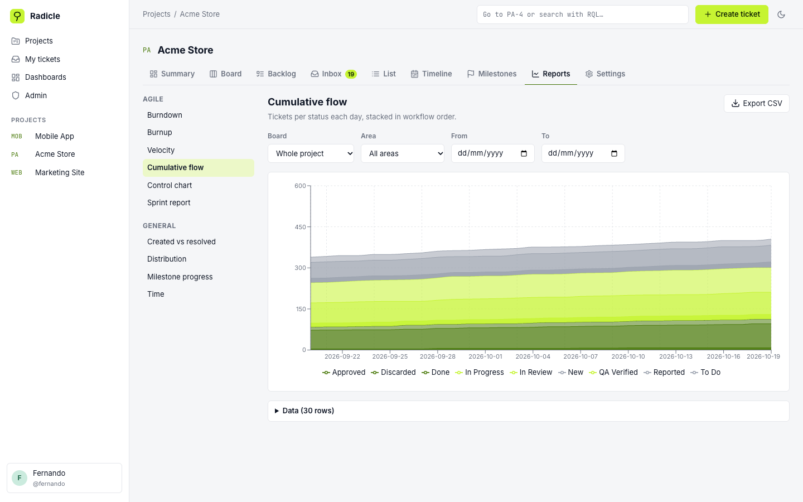</p>

**Dashboards** junta widgets en una cuadrícula que acomodas arrastrando: conteos, distribuciones, progreso de milestone, burndown, bloqueados, resultados de filtros y notas en markdown. Un dashboard puede ser privado, del proyecto o de toda la instancia, y cada quien ve solo los tickets que puede ver. Cada proyecto tiene su dashboard **Summary**.

<p align="center">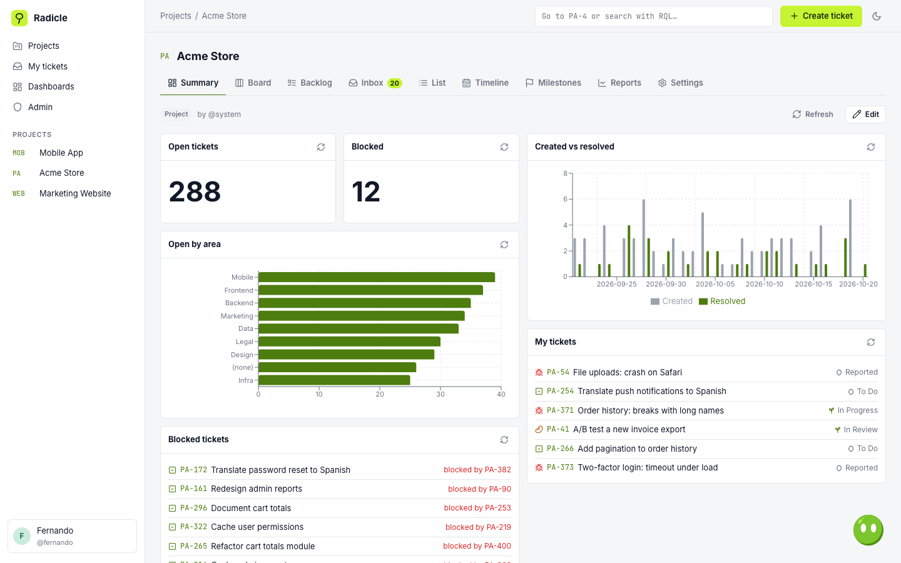</p>

### 9. Buzón y formulario público

>  **Radi:** Tus usuarios pueden decirte qué piensan, aunque no tengan cuenta. Sus ideas llegan aquí.

El **Buzón** (Inbox) junta Drafts: ideas del equipo, peticiones de agentes, y quejas, sugerencias e ideas de gente **sin cuenta** que usa el formulario público.

<p align="center">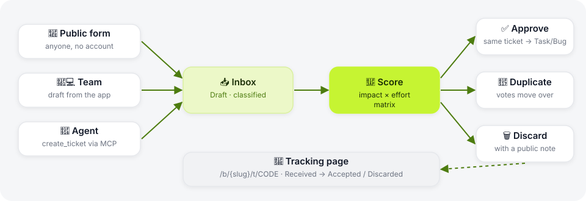</p>

**Abre el formulario público.** En **Settings → Inbox**, actívalo y elige el slug, los textos, qué tipos se pueden mandar, si el email es obligatorio, los adjuntos y el captcha. ALTCHA es el default y no depende de terceros; Turnstile y hCaptcha también funcionan. Luego comparte el link: `https://tu-radicle/b/<slug>`.

<p align="center">
  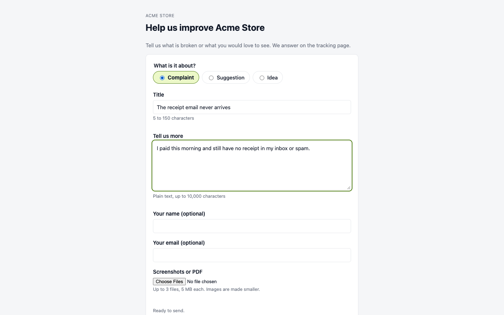
  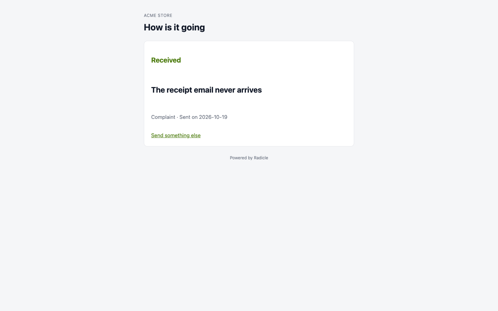
</p>

Cada envío recibe un **código de seguimiento**. La página de seguimiento muestra su estado (Recibido, En revisión, Aceptado o Cerrado) y tu nota pública, nunca detalles internos. Un honeypot, límites por IP, tiempo mínimo de llenado y límite de links frenan el spam.

**Triage.** El Buzón tiene pestañas New, In review, Approved y Discarded, con filtros por clasificación y origen.

- Califica cada entrada con **Impact** y **Effort** (de 1 a 5).
- Cambia a **Matrix** para ver los quick wins de un vistazo. Arrastra un punto para recalificarlo.
- **Approve and convert** convierte el Draft en Task o Bug en el mismo ticket, así que votos, comentarios e historial se conservan.
- **Mark duplicate** pasa sus votantes al original. **Discard** puede dejar una nota para quien lo mandó.

<p align="center">
  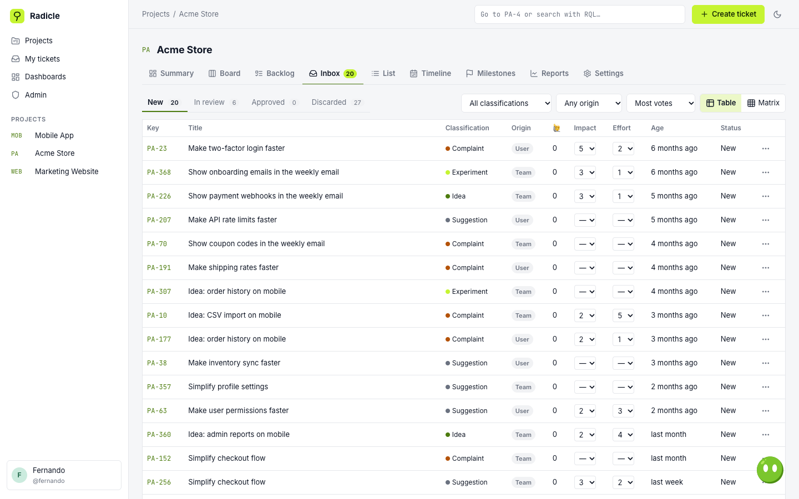
  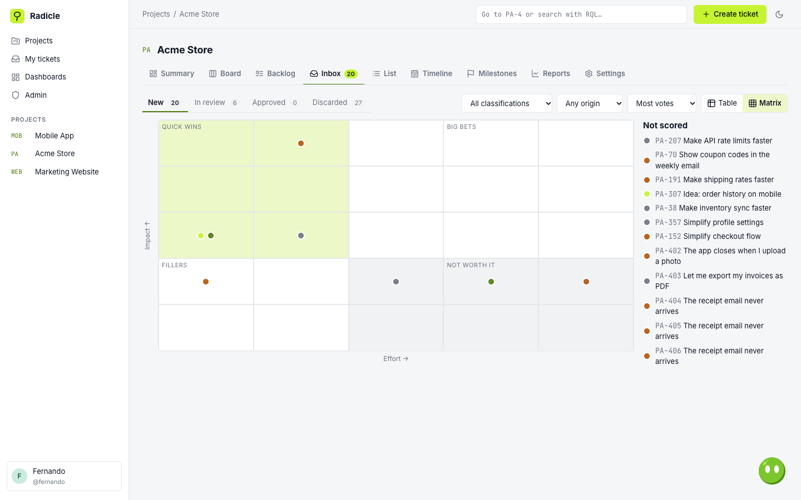
</p>

### 10. Permisos, grupos y tickets restringidos

>  **Radi:** Quién ve qué y quién puede hacer qué. Los tickets restringidos no existen para nadie más, ni para mí.

<p align="center">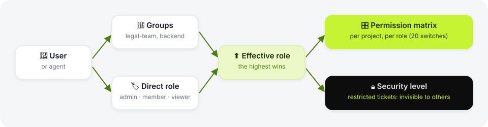</p>

- **Matriz de permisos** (**Settings → Permissions**): prende o apaga cada uno de los 20 permisos para members y viewers. Cubren crear, editar, mover y borrar tickets, comentarios, adjuntos, tiempo, votos, links, seguridad y triage del Buzón. La misma regla aplica en la UI (los botones desaparecen), la API (403 con el permiso que falta) y el MCP.
- **Niveles de seguridad** (**Settings → Levels**): crea un nivel como *Legal confidential* y dáselo a grupos o personas. Un ticket con ese nivel no existe para nadie más: ni en búsqueda, boards, reportes, dashboards, links, historial ni MCP. Si quieres, su reporter, assignee y colaboradores lo siguen viendo.

<p align="center">
  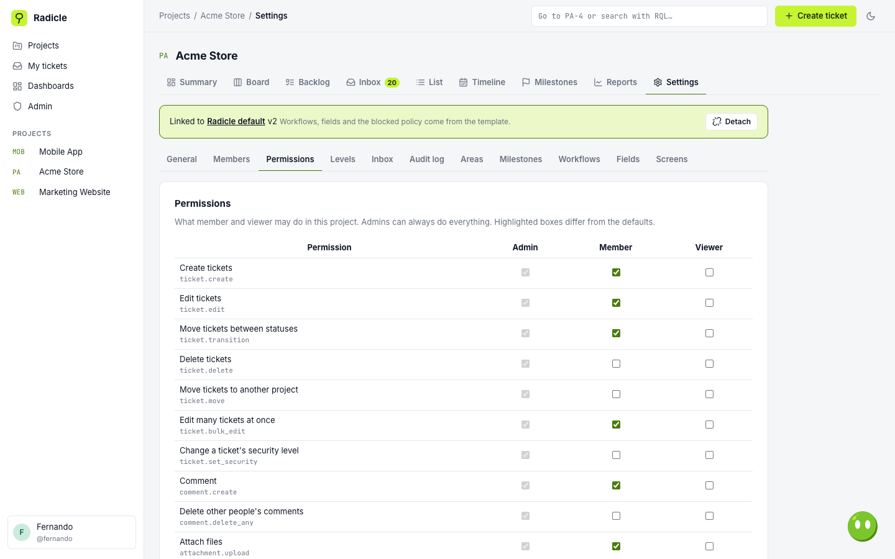
  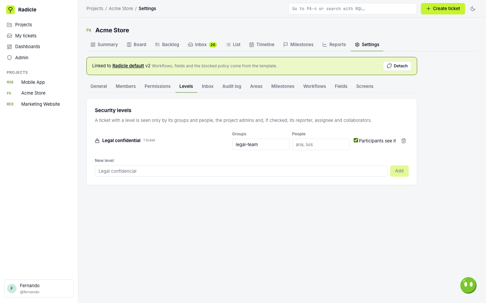
</p>

### 11. Single sign-on (SSO)

>  **Radi:** Que la gente entre con la cuenta que ya tiene.

En **Admin → SSO** agrega proveedores OpenID Connect (Google, Microsoft Entra ID, Okta, Keycloak, Authentik...) con su issuer URL, client ID y secret. Registra en tu proveedor la URL de callback que muestra el formulario.

- **Dominios permitidos**: deciden quién obtiene cuenta automáticamente. Una cuenta existente con el mismo email verificado se liga.
- **Mapeo de grupos**: sincroniza los grupos del proveedor con los de Radicle en cada entrada. Solo se tocan los grupos mapeados.
- En **Admin → Settings** puedes apagar la entrada con password. El primer admin de la instancia siempre puede entrar con su password: es tu salida de emergencia si el proveedor falla.

<p align="center">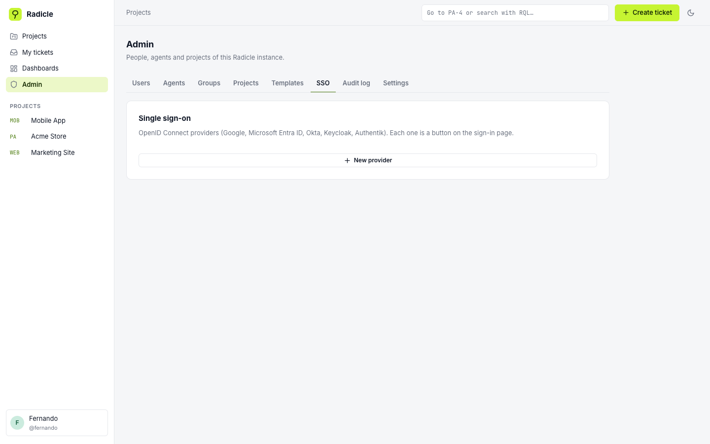</p>

### 12. Audit log

>  **Radi:** Cada cambio administrativo, anotado para siempre. Nadie puede editarlo, ni los admins.

**Admin → Audit log** registra 39 tipos de acciones administrativas: usuarios, tokens, agentes, proyectos, miembros, grupos, permisos, niveles de seguridad, borrados, movimientos, ediciones masivas, templates, workflows, ajustes del Buzón y SSO. Cada entrada dice quién, cuándo, desde qué IP y qué cambió (antes y después). Filtra por persona, acción, proyecto y fechas, y exporta a CSV. Los admins de proyecto ven las entradas de sus proyectos en **Settings → Audit log**.

El log es **de solo inserción**: la base de datos rechaza cambios y borrados. Las entradas con más de `RADICLE_AUDIT_RETENTION_DAYS` días (730 por default) se purgan.

<p align="center">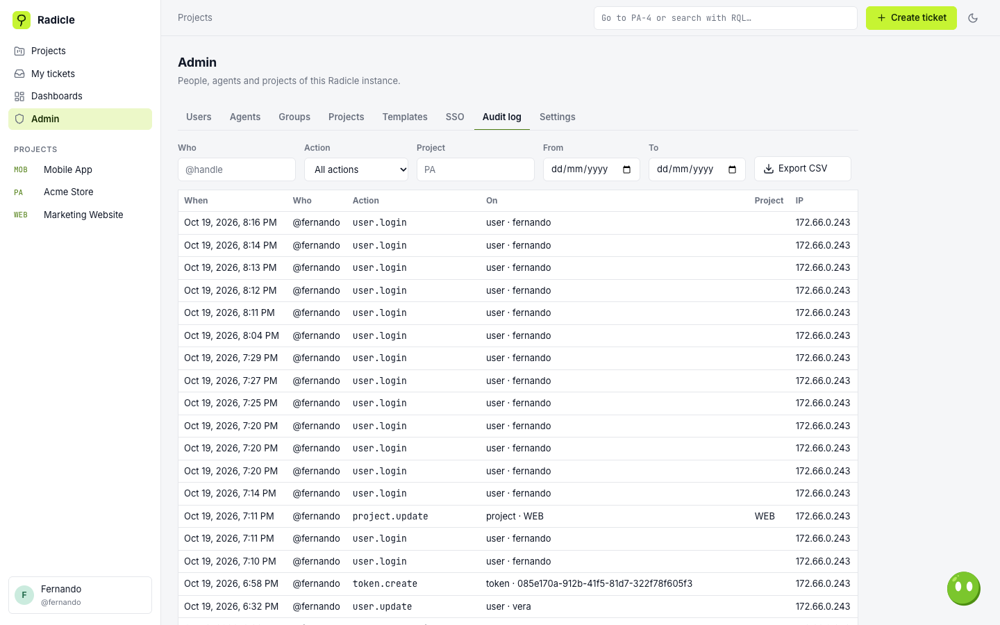</p>

### 13. Agentes de IA por MCP

>  **Radi:** Aquí los agentes son compañeros de equipo, como yo. Dales un token y un proyecto y se ponen a trabajar.

Los agentes son usuarios de tipo *agent*, con su propio handle, tokens, historial y permisos.

1. Ve a **Admin → Users → New user**, elige **Agent (LLM or worker)** y copia el token (`rdc_...`). Se muestra una sola vez, junto con los snippets de MCP listos para pegar. (**Admin → Agents → New agent** hace lo mismo.)
2. Elige qué puede hacer por MCP: deja **All tools**, elige **Read only** o marca las tools exactas; por ejemplo, un bot de triage que solo lee y califica el Buzón.
3. Agrégalo a un proyecto en **Settings → Members**, normalmente como **Member**.
4. Conecta tu cliente MCP.

<p align="center">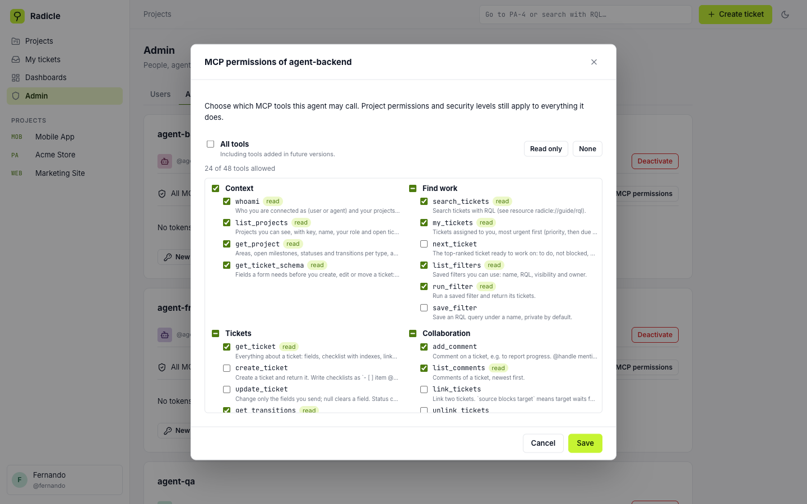</p>

Puedes cambiar las tools de un agente cuando quieras con **MCP permissions** en Users o Agents. Las que están apagadas desaparecen de su lista de tools y se rechazan si las llama. Se suman a los permisos del proyecto y a los niveles de seguridad, nunca los reemplazan. Cada cambio queda en el audit log.

**Claude Code**

```bash
claude mcp add --transport http radicle http://localhost:8000/mcp \
  --header "Authorization: Bearer rdc_xxxxxxxx"
```

**Clientes con configuración JSON** (Claude Desktop, Cursor, VS Code...)

```json
{
  "mcpServers": {
    "radicle": {
      "type": "http",
      "url": "http://localhost:8000/mcp",
      "headers": { "Authorization": "Bearer rdc_xxxxxxxx" }
    }
  }
}
```

Los clientes que solo hablan stdio pueden usar [`mcp-remote`](https://www.npmjs.com/package/mcp-remote) como puente: `npx -y mcp-remote http://localhost:8000/mcp --header "Authorization: Bearer rdc_xxxxxxxx"`.

Hay 48 tools, agrupadas en contexto, búsqueda de trabajo, tickets, colaboración, archivos y tiempo, planeación y Buzón. La lista completa está en el [README en inglés](README.md#13-ai-agents-over-mcp). Los agentes siguen la misma matriz de permisos y los mismos niveles de seguridad que las personas, y se pueden limitar a algunas tools.

### 14. Teclado, paleta de comandos y temas

>  **Radi:** ¿Manos en el teclado? Presiona <kbd>?</kbd> para ver todos los atajos.

Presiona <kbd>?</kbd> para ver todos los atajos. Los principales:

| Teclas | Acción |
| --- | --- |
| <kbd>⌘</kbd> <kbd>K</kbd> | Paleta de comandos: tickets, proyectos, filtros y acciones |
| <kbd>c</kbd> | Crear ticket |
| <kbd>/</kbd> | Buscar |
| <kbd>g</kbd> <kbd>p</kbd> · <kbd>g</kbd> <kbd>m</kbd> | Ir a proyectos · mis tickets |
| <kbd>j</kbd> / <kbd>k</kbd> | Moverse en listas y boards |
| <kbd>e</kbd> <kbd>a</kbd> <kbd>m</kbd> <kbd>l</kbd> <kbd>p</kbd> | En un ticket: editar título, asignarme, mover, tags, prioridad |

<p align="center">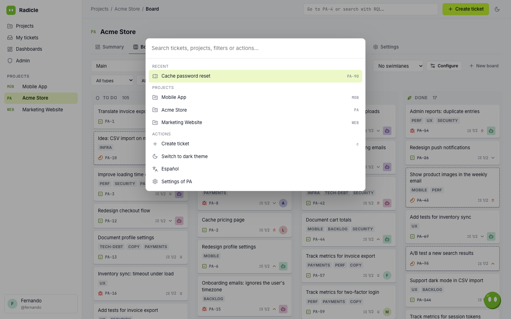</p>

Cambia entre claro y oscuro con el botón de la luna, y entre inglés y español en tu perfil o desde la paleta. Los atajos se pueden apagar en tu perfil.

**Úsalo como app de escritorio.** Radicle se puede instalar como app propia, con Radi en el Dock y su propia ventana: en Chrome da clic en **Instalar** en la barra de direcciones, o en Safari elige **Archivo → Añadir al Dock**.

## ⚙️ Configuración

>  **Radi:** Las perillas para quien administra Radicle.

Todo se configura con variables de entorno (ve [`.env.example`](.env.example)).

| Variable | Default | Qué hace |
| --- | --- | --- |
| `RADICLE_SECRET_KEY` | **obligatoria** | Cifra los secretos guardados (SSO, captcha) y firma links y la cookie del SSO. Genérala con `openssl rand -hex 32` y no la cambies después. |
| `RADICLE_BASE_URL` | `http://localhost:8000` | URL pública: cookies, snippets de MCP y links del formulario público. |
| `RADICLE_PORT` | `8000` | Puerto del contenedor `app` en el host. |
| `RADICLE_TIMEZONE` | `UTC` | Zona horaria de las fechas relativas en RQL y reportes. |
| `RADICLE_WORKDAYS` | `mon,tue,wed,thu,fri` | Días hábiles de los burndowns. |
| `RADICLE_STORAGE` | `local` | `local` guarda adjuntos en un volumen de Docker; `s3` usa cualquier S3 compatible (AWS, MinIO, R2) con `RADICLE_S3_*`. |
| `RADICLE_MAX_UPLOAD_MB` | `25` | Tamaño máximo por archivo. |
| `RADICLE_IMAGE_DEFAULT_RESIZE` | `large` | Tamaño default de imágenes: `original`, `large` (2048 px), `medium` o `small`. |
| `RADICLE_AUDIT_RETENTION_DAYS` | `730` | Días que se guarda el audit log. |
| `RADICLE_SESSION_DAYS` | `14` | Duración de la sesión (se renueva con el uso). |
| `RADICLE_ASSISTANT_*` | sin definir | El LLM de Radi; ve [Conoce a Radi](#-conoce-a-radi). Sin él, Radi responde con la guía. |
| `POSTGRES_*` | `radicle` | Credenciales de la base. Cambia el password en producción. |

El contenedor `worker` corre los trabajos en segundo plano: propagación de templates, variantes de imágenes, ediciones masivas grandes, ranking, snapshots diarios y retención del audit log. Si no está corriendo, esos trabajos esperan en la cola.

## 🏗️ Arquitectura

>  **Radi:** Cómo encajan las piezas: una app, un worker y una base de datos.

<p align="center">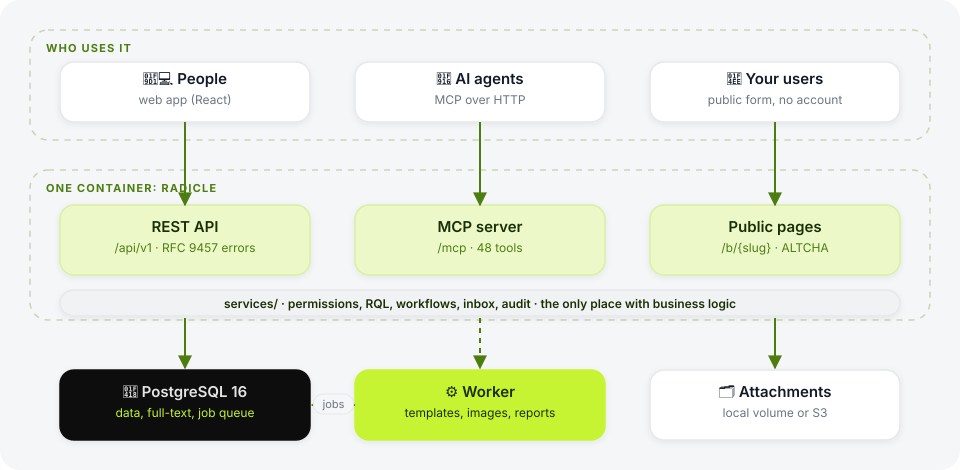</p>

| Capa | Stack |
| --- | --- |
| Backend | Python 3.12, FastAPI, SQLAlchemy 2 (async), Alembic, Pydantic 2, Procrastinate (jobs sobre Postgres), Authlib (OIDC) |
| Base de datos | PostgreSQL 16, con búsqueda full-text en inglés y español |
| Frontend | React 18, TypeScript, TanStack Router y Query, styled-components, dnd-kit, Recharts, i18next |
| MCP | SDK oficial de MCP para Python, Streamable HTTP en `/mcp` |
| Calidad | pytest con testcontainers (Postgres y Keycloak reales), mypy estricto, ruff, Vitest, E2E con Playwright |

La lógica de negocio vive solo en `backend/radicle/services/`. Los routers REST y las tools del MCP validan y llaman a esos servicios, así la UI, la API y los agentes siguen siempre las mismas reglas.

## 🧑‍💻 Desarrollo

>  **Radi:** ¿Quieres meterle mano a Radicle (o a mí)? Empieza aquí.

| Parte | Requisitos | Comandos |
| --- | --- | --- |
| Backend | Python 3.12, [uv](https://docs.astral.sh/uv/), Docker (para tests) | `cd backend && uv sync`, `uv run uvicorn radicle.main:app --reload`, `uv run pytest` |
| Frontend | Node 22, pnpm 9 | `cd frontend && pnpm install`, `pnpm dev` (proxy a `:8000`), `pnpm check` |
| Base local | Docker | `docker compose up -d db` y luego `cd backend && uv run alembic upgrade head` |

```bash
# Córrelo antes de cada push (el CI de GitHub Actions está en pausa por ahora)
cd backend && uv run ruff check . && uv run ruff format --check . && uv run mypy radicle && uv run pytest --cov
cd frontend && pnpm check && pnpm build
scripts/smoke.sh   # construye la imagen y la levanta en limpio en el puerto 8001
```

- Los tests de backend levantan PostgreSQL 16 con testcontainers (no SQLite). Los marcados `slow` también levantan Keycloak.
- Si cambias la API: `cd backend && uv run python ../scripts/export_openapi.py` y luego `cd frontend && pnpm api:types`.
- Datos de demo: `cd backend && uv run python ../scripts/seed.py --tickets 400 --project PA`, y entra como `fernando@example.com` / `radicle-demo`.
- Los documentos de diseño, decisiones (ADRs) y el progreso están en [`docs/`](docs/), en español.

## 🗺️ Roadmap y pendientes

>  **Radi:** Lo que sigue. ¡Las ideas son bienvenidas!

Las etapas 1 a 4 están completas: core y MCP, configuración y trabajo diario, planeación y visibilidad, y el Buzón con control de acceso. Esto es lo que sigue; las ideas y la ayuda son muy bienvenidas.

**Etapa 5: integraciones**

- [ ] Notificaciones (en la app y por email), watchers y suscripciones a filtros, incluido el email a quien mandó algo por el formulario público cuando cambia.
- [ ] Reglas de automatización ("cuando pase X, haz Y") y webhooks salientes.
- [ ] Integración con Git: un PR mergeado mueve su ticket a Done.
- [ ] Integraciones de chat (Slack, Microsoft Teams) y links a documentos.
- [ ] Importar y exportar (Jira, CSV, JSON).
- [ ] Sistema de plugins.
- [ ] App móvil nativa con notificaciones push.
- [ ] Más ayudas de IA: resúmenes, detección de duplicados, sugerencias de triage. (Radi, la guía dentro de la app, ya está.)

**Más adelante, quizá**

- [ ] SSO con SAML (hoy solo OpenID Connect).
- [ ] Roles además de admin, member y viewer.
- [ ] Más idiomas para la UI y el formulario público (hoy inglés y español).

**Pendientes y arreglos chicos** (buenas primeras contribuciones)

- [ ] El bundle principal del frontend pasa de 500 kB; hay que partirlo por ruta.
- [ ] El burndown dibuja cero en los días antes de iniciar un sprint cuando su fecha de inicio quedó en el pasado.
- [ ] El audit log muestra IDs internos en algunos objetivos (niveles de seguridad, proveedores SSO) en lugar de sus nombres.
- [ ] `test_periods.py` puede fallar de vez en cuando si dos cambios de estado comparten timestamp.

## 🤝 Cómo contribuir

>  **Radi:** Toda contribución cuenta, desde un typo hasta una feature. ¡Ven a saludar!

Radicle es un proyecto de la comunidad y toda contribución cuenta: reportes de bugs, documentación, traducciones, diseño y código.

<p align="center"></p>

En corto:

- **Una sola cosa por PR**, con sus tests.
- **PRs chicos**: menos de **500 líneas cambiadas** y menos de **100 archivos**. Si es más grande, pártelo en pasos.
- **Ramas** con el formato `tipo/descripcion-corta`:

| Tipo | Para qué | Ejemplo |
| --- | --- | --- |
| `feat/` | Algo nuevo | `feat/csv-import` |
| `minor/` | Cambios menores y ajustes | `minor/board-card-spacing` |
| `fix/` | Bugs | `fix/burndown-backdated-sprint` |
| `refactor/` | Reordenar código sin cambiar la funcionalidad | `refactor/split-ticket-service` |
| `docs/` | Solo documentación | `docs/sso-okta-guide` |

La guía completa, con el setup, las reglas de código, los mensajes de commit y cómo funcionan las revisiones, está en **[CONTRIBUTING.md](CONTRIBUTING.md)** (en inglés).

## 📜 Licencia

>  **Radi:** Software libre, y así se queda.

Radicle es software libre bajo la **[GNU Affero General Public License v3.0](LICENSE)** (AGPL-3.0-only).

En corto: puedes usar, estudiar, modificar y compartir Radicle, también en tu empresa y para trabajo comercial. Si lo modificas y dejas que otras personas usen tu versión, **incluso por red** (por ejemplo, si lo hospedas para tu equipo o tus clientes), tienes que ofrecerles el código fuente de tus cambios bajo la misma licencia. Así las mejoras regresan a la comunidad en lugar de quedarse en forks privados.

Al contribuir, aceptas que tus contribuciones se licencian bajo los mismos términos.
