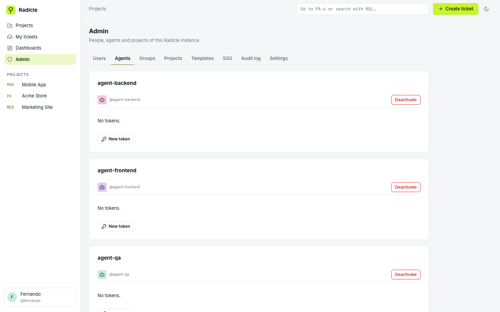

<p align="center">
  <picture>
    <source media="(prefers-color-scheme: dark)" srcset="docs/images/logo-dark.svg">
    
  </picture>
</p>

<p align="center">
  <b>The open source ticket tracker where people and AI agents work the same project.</b><br>
  Self-hosted · MCP built in · Inbox for your users · AGPLv3
</p>

<p align="center">
  <a href="LICENSE"></a>
  <a href="https://github.com/ego-mejia/radicle/actions/workflows/ci.yml"></a>
  <a href="CONTRIBUTING.md"></a>
  
  <a href="README.es.md"></a>
</p>

<p align="center">
  
</p>

> 🌱 **Radicle** is named after the radicle: the first root a seed puts out when it sprouts.

## Contents

- [Why Radicle](#-why-radicle)
- [Quick start](#-quick-start)
- [User guide](#-user-guide)
  - [1. Create your first project](#1-create-your-first-project)
  - [2. Add people](#2-add-people)
  - [3. Work with tickets](#3-work-with-tickets)
  - [4. Boards](#4-boards)
  - [5. Search with RQL](#5-search-with-rql)
  - [6. Sprints and backlog](#6-sprints-and-backlog)
  - [7. Timeline](#7-timeline)
  - [8. Reports and dashboards](#8-reports-and-dashboards)
  - [9. Inbox and public form](#9-inbox-and-public-form)
  - [10. Permissions, groups and restricted tickets](#10-permissions-groups-and-restricted-tickets)
  - [11. Single sign-on (SSO)](#11-single-sign-on-sso)
  - [12. Audit log](#12-audit-log)
  - [13. AI agents over MCP](#13-ai-agents-over-mcp)
  - [14. Keyboard, command palette and themes](#14-keyboard-command-palette-and-themes)
- [Configuration](#%EF%B8%8F-configuration)
- [Architecture](#%EF%B8%8F-architecture)
- [Development](#-development)
- [Roadmap and known issues](#%EF%B8%8F-roadmap-and-known-issues)
- [Contributing](#-contributing)
- [License](#-license)

## ✨ Why Radicle

| | |
| --- | --- |
| 🤖 **Agents are teammates** | A Model Context Protocol (MCP) server ships inside the app. Claude, Cursor or any MCP client can take a ticket, move it, tick its checklist, log time and comment, and it all shows up in the history as done by that agent. |
| 📮 **Hear your users** | Every project can open a public form. Complaints and ideas land in an **Inbox**, you score them on an impact × effort matrix and turn the good ones into tasks or bugs. The sender follows it with a tracking code. |
| 🔒 **Serious access control** | Groups, a permission matrix per project, restricted tickets that are invisible everywhere (search, boards, reports, MCP), OpenID Connect SSO and an append-only audit log. |
| 🗺️ **Plan and see** | Kanban and Scrum boards, sprints, a timeline with forecasts, ten agile and general reports and drag-and-drop dashboards. |
| ⚡ **Fast to work in** | A query language (RQL), a command palette, keyboard shortcuts for everything and light and dark themes. In English and Spanish. |
| 🏠 **Yours** | One `docker compose up`. PostgreSQL, your server, your data. |

## 🚀 Quick start

You need Docker with Compose.

```bash
git clone https://github.com/ego-mejia/radicle.git
cd radicle
cp .env.example .env
# Required: a long random secret. It encrypts stored secrets and signs links.
echo "RADICLE_SECRET_KEY=$(openssl rand -hex 32)" >> .env
docker compose up -d
```

Open <http://localhost:8000>. The first visit shows a **setup** screen where you create the instance admin.

Three containers start: `app` (web app, REST API and MCP), `worker` (background jobs) and `db` (PostgreSQL 16). The REST API lives at `/api/v1` and its interactive docs at `/api/docs`.

> [!TIP]
> In production, put Radicle behind HTTPS and set `RADICLE_BASE_URL` to its public URL. Cookies switch to `Secure` on their own.

## 📖 User guide

### 1. Create your first project

From **Projects**, click **Create project**. Give it a name and a short **key** (2 to 10 uppercase letters or digits, like `PAY`). Every ticket gets the key as a prefix (`PAY-12`), and it cannot change later.

Pick a **template**. It brings the workflows (statuses and transitions for Task, Bug and Draft), custom fields and policies. Choose **Linked** to keep receiving the template's changes, or **Independent** to copy it once and edit it freely.

<p align="center"></p>

Then, in the project's **Settings**, add **Areas** (Backend, Mobile, Legal...) and **Milestones** (V1, V2...). Every task and bug belongs to an area; milestones are optional.

### 2. Add people

People are created by an instance admin in **Admin → Users**, or arrive through [SSO](#11-single-sign-on-sso). To give them access to a project, open **Settings → Members**, type their `@handle` and pick a role:

| Role | Can |
| --- | --- |
| **Viewer** | Read everything in the project and vote. |
| **Member** | Everything a viewer can, plus create, edit, move and comment on tickets. |
| **Admin** | Everything, plus manage members, settings, workflows and permissions. |

<p align="center"></p>

For teams, create a **group** in **Admin → Groups** (for example `legal-team`) and give the group a role in the project. Everyone in it gets access at once, and so does anyone who joins the group later. When someone has several roles (direct and through groups), the highest one wins.

AI agents are added the same way: see [AI agents over MCP](#13-ai-agents-over-mcp).

### 3. Work with tickets

Press <kbd>c</kbd> or click **Create ticket**. There are three types:

- **Task**: work to do.
- **Bug**: something broken.
- **Draft**: an idea or request that is not decided yet. Drafts live in the [Inbox](#9-inbox-and-public-form).

<p align="center"></p>

A ticket has a markdown description with a **checklist**, plus priority, area, milestone, assignee, collaborators, dates, estimate, tags and a parent. Below that you find attachments (images are resized for you), subtickets, links (`blocks`, `relates to`, `duplicates`, `clones`), comments with `@mentions` and reactions, and the full **history**.

- **Move it** with the status button. Workflows can ask for a resolution, a comment or a finished checklist before a transition.
- **Log time** with **Log time**. Spent and remaining hours update right away.
- **Vote** with 🙋 to show it matters to you.
- From the **⋯** menu you can clone it, move it to another project or delete it (admins can restore deleted tickets).

<p align="center"></p>

### 4. Boards

Each project starts with a Kanban board called **Main**. Drag cards between columns. Quick filters (**My tickets**, **Only bugs**, `#backlog`, **Blocked**) and the filter bar narrow it down. Swimlanes split it by area, assignee, priority, milestone, parent or type.

<p align="center"></p>

Admins create more boards with **New board** and set them up in **Configure**:

- **Source**: an RQL query, so a board can cover one area or several projects.
- **Columns**: by status or by category, with **WIP limits**. Soft limits turn the column red; hard limits block the move (an admin can force it).
- **Card fields** and **quick filters**.

### 5. Search with RQL

RQL (Radicle Query Language) works in the search bar, in **List**, in boards and in saved filters:

```text
type = bug AND priority >= high AND assignee = currentUser()
project IN (PA, MOB) AND category != done ORDER BY due ASC
text ~ "checkout" AND updated >= -7d
sprint = active AND #backlog
classification = complaint AND origin = user ORDER BY votes DESC
```

Mistakes are underlined in place, with what was expected, and the editor autocompletes fields and values. Save a query as a **filter** to reuse it, share it or put it on a dashboard. Agents read the full guide as the MCP resource `radicle://guide/rql`.

<p align="center"></p>

### 6. Sprints and backlog

Create a board of kind **Scrum** to plan in sprints. Then, in **Backlog**:

1. Click **New sprint** and set a goal, dates and capacity in hours.
2. Drag tickets in. The bar shows committed hours against capacity and warns about tickets without an estimate.
3. **Start sprint**. What is inside becomes the commitment.
4. **Complete sprint**. Unfinished tickets go back to the backlog (tagged `#backlog`) or to the next sprint, and the sprint report is saved.

<p align="center"></p>

### 7. Timeline

**Timeline** draws tickets over time, grouped by milestone or area, by week, month or quarter. Drag a bar to change its dates, or drag a ticket from **Without dates** onto the timeline to give it some. Impossible dependencies (a ticket that starts before what blocks it ends) turn red, and milestones show their forecast.

<p align="center"></p>

### 8. Reports and dashboards

**Reports** has burndown, burnup, velocity, cumulative flow, control chart, sprint report, created vs resolved, distribution, milestone progress (with a forecast and an "at risk" flag) and time. Each one comes with its data table and **Export CSV**.

<p align="center"></p>

**Dashboards** put widgets on a grid you arrange by dragging: counts, distributions, milestone progress, burndown, blocked tickets, filter results and markdown notes. A dashboard can be private, shared with a project or shared with the whole instance, and everyone sees only the tickets they are allowed to see. Each project has its own **Summary** dashboard.

<p align="center"></p>

### 9. Inbox and public form

The **Inbox** collects Drafts: ideas from the team, requests from agents, and complaints, suggestions and ideas from people **without an account** who use the public form.

<p align="center"></p>

**Open the public form.** In **Settings → Inbox**, switch it on and choose the slug, the texts, which kinds people can send, whether email is required, attachments and the captcha. ALTCHA is the default and needs no third party; Turnstile and hCaptcha also work. Then share the link: `https://your-radicle/b/<slug>`.

<p align="center">
  
  
</p>

Every submission gets a **tracking code**. The tracking page shows its state (Received, In review, Accepted or Closed) and your public note, never internal details. A honeypot, rate limits, a minimum fill time and link limits keep spam out.

**Triage.** The Inbox has tabs for New, In review, Approved and Discarded, with filters by classification and origin.

- Score each item with **Impact** and **Effort** (1 to 5).
- Switch to **Matrix** to see the quick wins at a glance. Drag a dot to rescore it.
- **Approve and convert** turns the Draft into a Task or Bug in the same ticket, so votes, comments and history stay.
- **Mark duplicate** moves its voters to the original. **Discard** can leave a note for the sender.

<p align="center">
  
  
</p>

### 10. Permissions, groups and restricted tickets

<p align="center"></p>

- **Permission matrix** (**Settings → Permissions**): switch each of the 20 permissions on or off for members and viewers. They cover creating, editing, moving and deleting tickets, comments, attachments, time, votes, links, security and inbox triage. The same rule applies in the UI (buttons disappear), the API (403 naming the missing permission) and MCP.
- **Security levels** (**Settings → Levels**): create a level like *Legal confidential* and grant it to groups or people. A ticket with that level does not exist for anyone else: not in search, boards, reports, dashboards, links, history or MCP. If you want, its reporter, assignee and collaborators can still see it.

<p align="center">
  
  
</p>

### 11. Single sign-on (SSO)

In **Admin → SSO**, add OpenID Connect providers (Google, Microsoft Entra ID, Okta, Keycloak, Authentik...) with their issuer URL, client ID and secret. Register the callback URL shown in the form with your provider.

- **Allowed domains** decide who gets an account automatically. An existing account with the same verified email is linked.
- **Group mapping** syncs the provider's groups with Radicle groups on every sign-in. Only mapped groups are touched.
- In **Admin → Settings** you can turn off password sign-in. The first instance admin can still sign in with a password: that is your way back in if the provider fails.

<p align="center"></p>

### 12. Audit log

**Admin → Audit log** records 39 kinds of administrative actions: users, tokens, agents, projects, members, groups, permissions, security levels, deletions, moves, bulk edits, templates, workflows, Inbox settings and SSO. Each entry says who, when, from which IP, and what changed (before and after). Filter by person, action, project and dates, and export to CSV. Project admins see their projects' entries in **Settings → Audit log**.

The log is **append-only**: the database itself rejects updates and deletes. Entries older than `RADICLE_AUDIT_RETENTION_DAYS` (730 by default) are purged.

<p align="center"></p>

### 13. AI agents over MCP

Agents are users of kind *agent*, with their own handle, tokens, history and permissions.

1. Go to **Admin → Agents → New agent** and copy the token (`rdc_...`). It is shown only once, together with ready-to-paste MCP snippets.
2. Add the agent to a project in **Settings → Members**, usually as **Member**.
3. Connect your MCP client.

<p align="center"></p>

**Claude Code**

```bash
claude mcp add --transport http radicle http://localhost:8000/mcp \
  --header "Authorization: Bearer rdc_xxxxxxxx"
```

**Clients with a JSON config** (Claude Desktop, Cursor, VS Code...)

```json
{
  "mcpServers": {
    "radicle": {
      "type": "http",
      "url": "http://localhost:8000/mcp",
      "headers": { "Authorization": "Bearer rdc_xxxxxxxx" }
    }
  }
}
```

Clients that only speak stdio can use [`mcp-remote`](https://www.npmjs.com/package/mcp-remote) as a bridge: `npx -y mcp-remote http://localhost:8000/mcp --header "Authorization: Bearer rdc_xxxxxxxx"`.

<details>
<summary><b>All 48 tools</b></summary>

| Group | Tools |
| --- | --- |
| Context | `whoami`, `list_projects`, `get_project`, `get_ticket_schema` |
| Find work | `search_tickets`, `my_tickets`, `next_ticket`, `list_filters`, `run_filter`, `save_filter` |
| Tickets | `get_ticket`, `create_ticket`, `update_ticket`, `get_transitions`, `transition_ticket`, `change_ticket_type`, `set_checklist_item`, `clone_ticket`, `move_ticket`, `bulk_update`, `rank_ticket`, `get_history` |
| Collaboration | `add_comment`, `list_comments`, `link_tickets`, `unlink_tickets`, `add_collaborator`, `remove_collaborator` |
| Files and time | `upload_attachment`, `list_attachments`, `read_attachment`, `log_work`, `list_worklogs` |
| Planning | `list_boards`, `get_board`, `list_sprints`, `get_sprint`, `add_to_sprint`, `remove_from_sprint`, `start_sprint`, `complete_sprint`, `get_milestone_progress`, `get_report` |
| Inbox | `list_inbox`, `score_inbox_item`, `approve_inbox_item`, `discard_inbox_item`, `mark_inbox_duplicate` |

Resources: `radicle://guide/rql` and `radicle://projects/{key}/schema`. Agents follow the same permission matrix and security levels as people.

</details>

### 14. Keyboard, command palette and themes

Press <kbd>?</kbd> to see every shortcut. The main ones:

| Keys | Action |
| --- | --- |
| <kbd>⌘</kbd> <kbd>K</kbd> | Command palette: tickets, projects, filters and actions |
| <kbd>c</kbd> | Create ticket |
| <kbd>/</kbd> | Search |
| <kbd>g</kbd> <kbd>p</kbd> · <kbd>g</kbd> <kbd>m</kbd> | Go to projects · my tickets |
| <kbd>j</kbd> / <kbd>k</kbd> | Move through lists and boards |
| <kbd>e</kbd> <kbd>a</kbd> <kbd>m</kbd> <kbd>l</kbd> <kbd>p</kbd> | On a ticket: edit title, assign to me, move, tags, priority |

<p align="center"></p>

Switch between light and dark with the moon button, and between English and Spanish in your profile or from the palette. You can turn shortcuts off in your profile.

## ⚙️ Configuration

Everything is set with environment variables (see [`.env.example`](.env.example)).

| Variable | Default | What it does |
| --- | --- | --- |
| `RADICLE_SECRET_KEY` | **required** | Encrypts stored secrets (SSO, captcha) and signs links and the SSO cookie. Generate it with `openssl rand -hex 32` and never change it afterwards. |
| `RADICLE_BASE_URL` | `http://localhost:8000` | Public URL, used for cookies, MCP snippets and public form links. |
| `RADICLE_PORT` | `8000` | Host port of the app container. |
| `RADICLE_TIMEZONE` | `UTC` | Time zone for relative dates in RQL and reports. |
| `RADICLE_WORKDAYS` | `mon,tue,wed,thu,fri` | Working days for burndowns. |
| `RADICLE_STORAGE` | `local` | `local` keeps attachments in a Docker volume; `s3` uses any S3-compatible store (AWS, MinIO, R2) with `RADICLE_S3_*`. |
| `RADICLE_MAX_UPLOAD_MB` | `25` | Maximum size per file. |
| `RADICLE_IMAGE_DEFAULT_RESIZE` | `large` | Default image size: `original`, `large` (2048 px), `medium` or `small`. |
| `RADICLE_AUDIT_RETENTION_DAYS` | `730` | Days the audit log is kept. |
| `RADICLE_SESSION_DAYS` | `14` | Session length (sliding). |
| `POSTGRES_*` | `radicle` | Database credentials. Change the password in production. |

The `worker` container runs background jobs: template propagation, image variants, large bulk edits, ranking, daily snapshots and audit retention. If it is down, those jobs wait in the queue.

## 🏗️ Architecture

<p align="center"></p>

| Layer | Stack |
| --- | --- |
| Backend | Python 3.12, FastAPI, SQLAlchemy 2 (async), Alembic, Pydantic 2, Procrastinate (jobs on Postgres), Authlib (OIDC) |
| Database | PostgreSQL 16, with full-text search in English and Spanish |
| Frontend | React 18, TypeScript, TanStack Router and Query, styled-components, dnd-kit, Recharts, i18next |
| MCP | Official Python MCP SDK, Streamable HTTP at `/mcp` |
| Quality | pytest with testcontainers (real Postgres and Keycloak), mypy strict, ruff, Vitest, Playwright E2E |

Business logic lives only in `backend/radicle/services/`. The REST routers and the MCP tools validate input and call those services, so the UI, the API and agents always follow the same rules.

## 🧑‍💻 Development

| Part | Needs | Commands |
| --- | --- | --- |
| Backend | Python 3.12, [uv](https://docs.astral.sh/uv/), Docker (for tests) | `cd backend && uv sync`, `uv run uvicorn radicle.main:app --reload`, `uv run pytest` |
| Frontend | Node 22, pnpm 9 | `cd frontend && pnpm install`, `pnpm dev` (proxies to `:8000`), `pnpm check` |
| Local database | Docker | `docker compose up -d db`, then `cd backend && uv run alembic upgrade head` |

```bash
# Everything CI runs
cd backend && uv run ruff check . && uv run ruff format --check . && uv run mypy radicle && uv run pytest --cov
cd frontend && pnpm check && pnpm build
scripts/smoke.sh   # builds the image and runs it from scratch on port 8001
```

- Backend tests start PostgreSQL 16 with testcontainers (no SQLite). Tests marked `slow` also start Keycloak.
- If you change the API: `cd backend && uv run python ../scripts/export_openapi.py`, then `cd frontend && pnpm api:types`.
- Demo data: `cd backend && uv run python ../scripts/seed.py --tickets 400 --project PA`, then sign in as `fernando@example.com` / `radicle-demo`.
- Design documents, decisions (ADRs) and progress notes live in [`docs/`](docs/). They are written in Spanish.

## 🗺️ Roadmap and known issues

Stages 1 to 4 are complete: core and MCP, configuration and daily work, planning and visibility, and the Inbox with access control. This is what comes next. Ideas and help are very welcome.

**Stage 5: integrations**

- [ ] Notifications (in-app and email), watchers and subscriptions to filters, including an email to public-form senders when their item changes.
- [ ] Automation rules ("when X, do Y") and outgoing webhooks.
- [ ] Git integration: a merged PR moves its ticket to Done.
- [ ] Chat integrations (Slack, Microsoft Teams) and links to docs.
- [ ] Import and export (Jira, CSV, JSON).
- [ ] A plugin system.
- [ ] A native mobile app with push notifications.
- [ ] AI helpers: summaries, duplicate detection, triage suggestions.

**Later, maybe**

- [ ] SAML single sign-on (only OpenID Connect today).
- [ ] Roles beyond admin, member and viewer.
- [ ] More languages for the UI and the public form (English and Spanish today).

**Known issues and small fixes** (good first contributions)

- [ ] The main frontend bundle is over 500 kB; split it by route.
- [ ] The burndown draws zero for the days before a sprint was started when its start date is set in the past.
- [ ] The audit log shows internal IDs for some targets (security levels, SSO providers) instead of their names.
- [ ] `test_periods.py` can fail now and then when two status changes share the same timestamp.

## 🤝 Contributing

Radicle is a community project, and contributions of every size are welcome: bug reports, docs, translations, design and code.

<p align="center"></p>

The short version:

- **One thing per PR**, with its tests.
- **Small PRs**: under **500 changed lines** and under **100 files**. Split bigger work into steps.
- **Branches** are named `type/short-description`:

| Type | Use it for | Example |
| --- | --- | --- |
| `feat/` | Something new | `feat/csv-import` |
| `minor/` | Small changes and tweaks | `minor/board-card-spacing` |
| `fix/` | Bug fixes | `fix/burndown-backdated-sprint` |
| `refactor/` | Reordering code without changing behavior | `refactor/split-ticket-service` |
| `docs/` | Documentation only | `docs/sso-okta-guide` |

Read **[CONTRIBUTING.md](CONTRIBUTING.md)** for the full guide: setup, code rules, commit messages and how reviews work. New here? Pick something from the [known issues](#%EF%B8%8F-roadmap-and-known-issues) or open an issue to say hi.

## 📜 License

Radicle is free software under the **[GNU Affero General Public License v3.0](LICENSE)** (AGPL-3.0-only).

In short: you can use, study, modify and share Radicle, including at your company and for commercial work. If you change it and let other people use your version, **including over a network** (for example, hosting it for your team or your customers), you must offer them the source code of your changes under the same license. That way, improvements come back to the community instead of staying in private forks.

By contributing, you agree that your contributions are licensed under the same terms.
