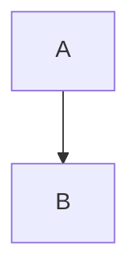

# Conecta un agente

Texto **negrita** y `código` con [link](https://radicle.dev)\
@fernando :status[Listo]{color=green}

## Antes de empezar

- uno
- dos

1. primero

- [x] hecho
- [ ] pendiente

> Una cita

```python
print('hola')
```

| Campo | Regla |
|---|---|
| Título | 1 a 200 |

:::panel
Ojo con el token.
:::

:::expand{title="Más"}
Detalles
:::

::::columns{layout=two}
:::column
izquierda
:::
:::column
derecha
:::
::::

[[toc]]

[[children]]

{size=large align=center}

::file{asset=a1 name=spec.pdf type=application/pdf size=1024}

::video{src=https://example.com/v.mp4 caption=Demo}

```visual{format=svg title="Raíz" description="Un círculo lima: la semilla de Radicle."}
<svg viewBox="0 0 10 10"><circle cx="5" cy="5" r="4" fill="var(--accent)"/></svg>
```



```chart{kind=bar title="Tickets por área"}
| Área | Abiertos | Cerrados |
|---|---|---|
| Legal | 3 | 5 |
| Backend | 7 | 2.5 |
```

```timeline
2026-11-01 | Beta | Equipo interno
 | Lanzamiento
```

```math
E = mc^2
```

::::compare
:::side{title=Antes}
rápido
:::
:::side
más rápido
:::
::::

::pages{label=onboarding limit=5 space=docs}

::database{id=6f1c3a52-9d2e-4b8a-a1f0-3c5e7d9b2a14 view=board}

::embed{url="https://www.youtube.com/watch?v=dQw4w9WgXcQ" title="La demo"}

---

Fin
